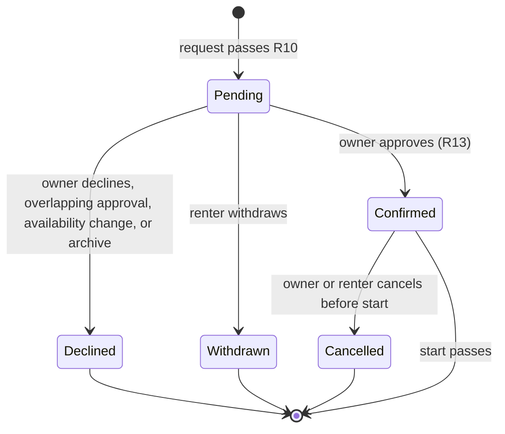

# Slotted room booking

This file is the whole requirement for the Slotted design. Write the design in
Sigil 0.9, in `design/`. The IDs below (R, AE, F, and KTD) come from the Slotted
plan. Cite them where they apply.

## Goal

- **Objective:** Signed-in users can list rooms with weekly hours and blackouts,
  request time on other people's rooms, have the owner approve or decline those
  requests, and read a room calendar that never shows two confirmed bookings
  overlapping.
- **Means:** A modular monolith in one Next.js app, with the no-overlap rule
  enforced by Postgres (KTD2, KTD5).
- **Product authority:** The product contract below wins on behavior. The
  technical decisions (KTDs) win on mechanism within it. Slotted is a reference
  app for exercising Sigil design and the build pipeline, so behavioral
  coherence outranks market fit.

## Product contract

### Summary

Slotted is a single authenticated app where any user can own rooms and rent
other people's rooms. Owners set weekly open hours and blackout dates. Renters
submit requests that stay Pending until the owner approves or declines. Each
room's calendar shows open time and bookings for a chosen date range, with
detail depending on who is looking.

### Problem frame

Slotted exists to exercise Sigil design and a full build pipeline on a domain
with real rules: two roles, a request lifecycle, time-zone arithmetic, and a
concurrency invariant. A toy CRUD app would not stress those. A real marketplace
would bury them under payments and discovery.

### Actors

- A1. Owner: a user acting on a room they created. Sets metadata and
  availability, triages requests, cancels bookings.
- A2. Renter: a user acting on a room they do not own. Browses rooms, submits
  and withdraws requests, cancels their bookings.
- A3. Slotted: enforces availability and conflict rules and performs automatic
  declines.

### Key decisions

- **Owner approval, not instant booking.** Exercises a real request lifecycle
  and gives both roles work. Governs R12, R13. Chosen over auto-confirm-if-free
  and a per-room instant-book setting: a reference app should exercise the full
  request state machine with one path to specify.
- **Only Confirmed bookings block; approval auto-declines overlapping Pending
  requests.** No renter can squat a slot by asking. Governs R10, R11, R14.
  Chosen over Pending requests holding the slot and over the owner resolving
  overlaps by hand: avoids squatting without leaving the owner cleanup work.
- **Weekly hours plus whole-day blackouts.** Covers holidays with one precedence
  rule. Governs R6, R7. Chosen over weekly-only hours and over date overrides
  that can also open time: enough expressiveness with the fewest precedence
  rules.
- **Edits to availability never cancel Confirmed bookings.** The owner keeps
  control of cancellations. Governs R8. Chosen over blocking the edit and over
  auto-cancelling affected bookings: rule changes stay cheap and nothing
  confirmed disappears silently.
- **Withdraw and two-sided cancel, no expiry.** Governs R15, R16, R17. Chosen
  over withdraw-only and over adding auto-expiry: both parties can exit before
  start without extra background behavior.
- **Owner sees everything; renters see busy blocks.** Protects renter identity.
  Governs R20, R21. Chosen over one shared view and over full transparency:
  owners need a triage view and renters should not see each other.
- **Roles come from the relationship, not the account.** Governs R1, R2. Chosen
  over a fixed role at signup and over a switchable mode: one person can own and
  rent without two accounts.
- **Room timezone and a 30-minute grid with half-open ranges.** Governs R9, R27.
  Chosen over any-minute ranges and whole-day bookings: keeps the calendar tidy
  and back-to-back bookings conflict-free.
- **Room timezone is locked while upcoming items exist.** No booking ever moves
  in time. Governs R22. Chosen over treating a timezone change as an
  availability edit and over keeping wall-clock times: the simplest rule, with
  no silent re-validation.

### Requirements

- R1. Every part of Slotted requires sign-in, and there is a single account
  type.
- R2. A user is an Owner for rooms they created and a Renter for requests they
  submitted; a user cannot request a room they own.
- R3. An Owner can create and edit a room with a name, description, capacity,
  location text, and timezone; capacity is informational and requests carry no
  party size.
- R4. An Owner can archive a room; an archived room accepts no new requests, its
  Pending requests are auto-declined, and its Confirmed bookings stand until
  cancelled.
- R23. An Owner can unarchive a room; unarchiving revives no Declined request.
- R5. Any signed-in user can browse a list of all non-archived rooms and open
  any room's calendar.
- R22. A room's timezone cannot be changed while the room has any Pending or
  Confirmed item whose start is in the future.
- R6. An Owner defines weekly open windows per weekday in room-local time on
  30-minute boundaries, with any number of non-overlapping windows per day.
- R7. An Owner can add and remove blackouts covering whole room-local dates;
  open time is the weekly windows minus blackouts.
- R8. Edits to availability apply to future items only: Confirmed bookings that
  have not started and are now outside open time stay Confirmed and are flagged
  to the Owner, and Pending requests that have not started and are now outside
  open time are auto-declined; started bookings and expired requests are
  untouched.
- R9. Every requested range is in room-local time, starts and ends on 30-minute
  boundaries, is half-open so a booking ending at 10:00 does not conflict with
  one starting at 10:00, starts in the future, and may span midnight or several
  days if every part lies within open time.
- R27. A requested start or end that does not exist in room-local time because
  of a daylight-saving jump is rejected; a local time that occurs twice resolves
  to its earlier occurrence.
- R25. A calendar view spans at most 31 days, a request may start at most 180
  days ahead, and a single request lasts at most 7 days; both request limits are
  measured in room-local calendar days, so a week that crosses a daylight-saving
  change still counts as 7 days.
- R10. A Renter's request is accepted as Pending only when the range lies wholly
  within open time (R7) and overlaps no Confirmed booking on that room;
  otherwise it is rejected and the Renter is told which condition failed.
- R28. Rejections report the first failing condition in this order: own room,
  archived room, off-grid or nonexistent local time, invalid range (end not
  after start), start not in the future, outside the limits in R25, outside open
  time, conflict with a Confirmed booking, exact duplicate.
- R24. A Renter cannot hold two Pending requests with the identical range on the
  same room.
- R11. Pending requests on the same room may overlap each other.
- R12. An Owner can approve or decline any Pending request on their room.
- R13. Approval re-checks R10 and requires the start to still be in the future;
  if the check fails, approval is refused and the request stays Pending.
- R14. Approving a request auto-declines every other Pending request on the same
  room whose range overlaps it.
- R15. A Renter can withdraw their own Pending request.
- R16. Either the Owner or the Renter can cancel a Confirmed booking before its
  start, with no reason or fee; cancelling a booking that is already Cancelled
  succeeds without change.
- R17. A booking whose start has passed can no longer change; a Pending request
  whose start has passed shows as expired, cannot be approved, and can still be
  declined or withdrawn.
- R26. Declined, Withdrawn, and Cancelled are terminal; later availability
  changes or cancellations reopen time only for new requests.
- R18. No two Confirmed bookings on the same room ever overlap, including when
  approvals happen at the same time.
- R19. Each Renter sees their requests and bookings, and each Owner sees the
  requests and bookings on their rooms, with current status: Pending, Confirmed,
  Declined, Withdrawn, or Cancelled; declines show their cause (declined by
  owner, overlapping approval, availability change, or archive).
- R20. The Owner's calendar for a selected date range shows open time,
  blackouts, Confirmed bookings with renter identity, Pending requests, and any
  Confirmed bookings flagged under R8.
- R21. Any other user's calendar for a selected date range shows open time,
  other renters' Confirmed bookings as anonymous booked blocks, and that user's
  own Pending requests and Confirmed bookings marked as theirs.

### Request lifecycle

An expired Pending request (R17) stays in Pending until declined or withdrawn.

### Key flows

- F1. Owner sets up a room
  - **Trigger:** A user creates a room.
  - **Actors:** A1
  - **Steps:** Enter metadata and timezone; add weekly windows; optionally add
    blackouts; the room appears in the room list.
  - **Covered by:** R3, R5, R6, R7, R22
- F2. Renter requests time
  - **Trigger:** A Renter opens a room's calendar and picks a range.
  - **Actors:** A2, A3
  - **Steps:** The Renter views open time and booked blocks and submits a range;
    Slotted checks it and records a Pending request or rejects it with the
    reason.
  - **Covered by:** R9, R10, R11, R24, R25, R27, R28, R21
- F3. Owner triages requests
  - **Trigger:** The Owner reviews Pending requests on their room.
  - **Actors:** A1, A3
  - **Steps:** The Owner approves or declines; on approval Slotted re-checks,
    confirms, and auto-declines overlapping Pending requests; both parties see
    the new status.
  - **Covered by:** R12, R13, R14, R18, R19, R20
- F4. Exit before start
  - **Trigger:** A party no longer wants the time.
  - **Actors:** A1, A2
  - **Steps:** The Renter withdraws a Pending request, or either party cancels a
    Confirmed booking; the time becomes requestable again.
  - **Covered by:** R15, R16, R17, R26

### Acceptance examples

- AE1. **Covers R9, R10.** Given a Confirmed booking 09:00–10:00, when a Renter
  requests 10:00–11:00, then the request is accepted as Pending.
- AE2. **Covers R10.** Given weekly hours Mon 09:00–18:00, when a Renter
  requests Mon 17:30–18:30, then the request is rejected as outside
  availability.
- AE3. **Covers R11, R14, R19.** Given Pending requests from Ana for 13:00–15:00
  and Ben for 14:00–16:00, when the Owner approves Ana's, then Ana's is
  Confirmed and Ben's is Declined with cause "overlapping approval".
- AE4. **Covers R8, R20.** Given a Confirmed booking on 24 Dec and a Pending
  request on 24 Dec, when the Owner blacks out 24 Dec, then the booking stays
  Confirmed and is flagged on the Owner's calendar, and the request is Declined
  with cause "availability change".
- AE5. **Covers R2.** Given a user who owns Room A, when they try to request
  Room A, then the request is refused.
- AE6. **Covers R17.** Given a Pending request starting at 09:00 today, when the
  Owner tries to approve it at 09:15, then approval is refused and the request
  shows as expired.
- AE7. **Covers R9.** Given a room open Fri 18:00–24:00 and Sat 00:00–02:00,
  when a Renter requests Fri 22:00–Sat 01:00, then it is accepted as Pending.
- AE8. **Covers R21.** Given Ana holds a Confirmed booking, when Ben views the
  calendar, then he sees a booked block with no name, and sees none of Ana's
  Pending requests.
- AE9. **Covers R18.** Given two overlapping Pending requests, when the Owner
  approves both at nearly the same moment, then exactly one becomes Confirmed.
- AE10. **Covers R22.** Given a room with a Confirmed booking next week, when
  the Owner tries to change its timezone, then the change is refused.
- AE11. **Covers R26.** Given a Pending request auto-declined by a blackout,
  when the Owner removes the blackout, then the request stays Declined and the
  Renter may submit a new one.
- AE12. **Covers R13, R15.** Given a Pending request, when the Owner approves it
  while the Renter withdraws it, then exactly one action succeeds and the other
  is told the request is no longer Pending.
- AE13. **Covers R27.** Given a room in America/New_York open all day, when a
  Renter requests a range starting 02:00 on the spring-forward date, then it is
  rejected as a nonexistent local time.

### Scope boundaries

**Deferred for later**

- Recurring bookings and repeat requests.
- Date overrides that open extra time, and per-room instant-book.
- Room search, filtering, and photos.
- Email, push, or real-time notifications; status is visible in the app only.
- Magic-link or social sign-in.

**Outside this product's identity**

- Payments, pricing, deposits, and refunds.
- Reviews, ratings, and owner–renter messaging.
- Organizations, teams, or delegated room management.

**Deferred to follow-up work**

- Deployment, hosting, and production observability; this work targets local
  development and CI.
- Moving from `temporal-polyfill` to native Temporal once the runtime moves to
  Node 26.

### Dependencies and assumptions

- Slotted is a reference app; demand, current workarounds, and market durability
  are deliberately not validated.
- Build constraint from the user: Slotted is a modular monolith shipped as a
  single Next.js app.
- The design targets Sigil 0.9, and there are no designs yet.
- Sign-in is email and password; no outbound email is required.

## Technical decisions

- KTD1. **Next.js 16.3 App Router on Node 22, TypeScript ~6.0.** This is the
  current stable line. Pin Next.js to 16.3.7 or later once the 2026-09-30
  security release ships. TypeScript stays on 6.0 because typescript-eslint does
  not yet support 7. `cacheComponents` stays off so every page renders
  dynamically.
- KTD2. **A modular monolith with strict boundaries.** Each module has one
  public entry, and no module may import another module's internals. Module
  dependencies have no cycles. The app's pages and server actions import only
  module public entries. The mutations that take a transaction (archive,
  unarchive, timezone change, and window and blackout edits) are exported from a
  second, transactional entry that the app never imports, so the app can reach
  them only through the workflows in KTD9. `eslint-plugin-boundaries` enforces
  this in lint, and `dependency-cruiser` re-checks it for cycles in CI.
- KTD3. **Better Auth 1.7 with email and password, backed by the Drizzle
  adapter.** Auth.js is security-fixes-only and Lucia is deprecated. The Better
  Auth catch-all is the app's only Route Handler. The Next.js proxy does an
  optimistic session-cookie redirect only. A server-only `requireUser()` is the
  real gate and is called by every page and server action (R1). `requireUser()`
  is a thin wrapper that passes the request headers to
  `getSessionUser(headers)`, which can be tested outside Next. Commands and
  queries take an explicit actor and never read the session themselves.
- KTD4. **Postgres 18 via Docker Compose, Drizzle ORM 0.45, and the `pg`
  driver.** Drizzle is used with `generate` and `migrate` only, never `push`, so
  hand-written SQL migrations survive. `pg` is shared with Better Auth to keep
  one driver. Prisma is rejected because npm `latest` is an 8.0 RC that Better
  Auth does not support, and ranges would need raw SQL anyway.
- KTD5. **R18 is enforced by a Postgres exclusion constraint.** The ranges of
  bookings are stored as UTC `tstzrange` values with `[)` bounds. A GiST
  exclusion on (room, range) applies only to Confirmed rows, uses `btree_gist`,
  and lives in a custom SQL migration. The resulting SQLSTATE 23P01 is mapped to
  a domain conflict error. PG 18 `WITHOUT OVERLAPS` is not used because it
  cannot be limited to Confirmed rows.
- KTD6. **Every room-scoped mutation runs in one transaction that first locks
  the room row.** Submit, approve, decline, withdraw, cancel, availability edit,
  archive, unarchive, and timezone edit all go through one room lock,
  `withRoomLock`. Each status change is a compare-and-set from the expected
  prior status. A lost race on a Pending item returns "no longer Pending"; a
  cancel that finds the item already Cancelled succeeds (R16). Item-scoped
  commands (approve, decline, withdraw, cancel) take only the item id, never a
  client-supplied room. They read the item's stored room, lock that room,
  re-load the item inside the lock, and authorize the actor against that room's
  owner or the item's renter (R12, R15, R16). This makes R13, R14, R22, R8, and
  AE12 exact; KTD5 remains the backstop for R18.
- KTD7. **Time uses Temporal through `temporal-polyfill`.**
  - The room stores an IANA zone.
  - Weekly windows are stored as (weekday, local start, local end), with end
    allowed to be 24:00. Blackouts are local dates. Bookings are UTC instants.
  - Open time for a range is computed per concrete local date and then converted
    to instants, never precomputed in UTC.
  - Nonexistent local times are rejected (R27). Ambiguous local times use the
    `earlier` disambiguation.
  - "Now" comes from a `Clock`. Server actions pass the system clock into every
    command and query. Every future-start, expired, and R25 check uses that
    clock and never database `now()`, so tests can create items before their
    start and act after it.
- KTD8. **"Expired" (R17) and "outside availability" (R8) are derived at read
  time, not stored.** Removing a blackout clears a flag automatically, and
  nothing needs a background job.
- KTD9. **Mutations are server actions and reads are Server Components; booking
  reads are never cached.** Each action re-verifies the session and ownership,
  then calls `refresh()` so the calendar reflects the write. Workflows that
  cross module lines, such as an availability edit plus its R8 sweep, are
  composed inside one `withRoomLock` call by the module that owns their outcome.
- KTD10. **The design is written in Sigil 0.9 before the code.** It uses goal,
  interface, state, logic, constraints, and cases contracts. Each Tag is defined
  once, by the part that owns it, and imported elsewhere. R18, R22, R26, and the
  per-room serialization (KTD6) belong in constraints; examples drawn from the
  AEs belong in cases.

## Technical design

### Approve transaction

Covers R13, R14, R18; KTD5, KTD6.

1. The Owner's server action calls `approve(actor, requestId, clock)`.
2. Begin a transaction, read the request's stored room, and lock that room row.
3. Re-load the request. Verify that the actor owns that room, the status is
   Pending, and the start is after `clock.now`.
4. Re-check R10 against current open time.
5. Set the request to Confirmed where its status is Pending. Postgres raises
   23P01 if an overlapping Confirmed booking exists.
6. Set every overlapping Pending request to Declined, with cause "overlapping
   approval".
7. Commit, return the result or a domain error, and `refresh()`.

### Open-time computation

Covers R6, R7, R27; KTD7. The computation takes weekly windows, blackouts, the
room's zone, and a local date range, and returns UTC spans.

1. Start from a local date range in the room's zone.
2. For each local date, take the weekly windows for that weekday.
3. Drop dates that are blacked out.
4. Merge adjacent spans, including 24:00 to the next day's 00:00.
5. Convert the local spans to UTC instants, dropping slots in a daylight-saving
   gap.
6. The result is the open time used by R10 checks, R8 sweeps, and the calendar.

### Time rules

Covers R6, R7, R9, R25, R27; KTD7. The rules for the 30-minute grid, local and
instant conversion, daylight-saving handling, half-open ranges, and open-time
computation are pure functions. They import no database or framework code.

Examples:

- 09:00 and 09:30 are on the grid; 09:15 is rejected.
- Covers AE1. [09:00,10:00) and [10:00,11:00) do not overlap; [09:00,10:30) and
  [10:00,11:00) do.
- Covers AE7. Fri 18:00–24:00 plus Sat 00:00–02:00 yields one continuous span,
  and Fri 22:00–Sat 01:00 is inside it.
- Covers AE13. In America/New_York, 02:00 on the spring-forward date is reported
  as nonexistent.
- In America/New_York, 01:30 on the fall-back date resolves to the earlier
  instant.
- A window 01:00–04:00 on the spring-forward date yields 2 real hours of open
  time.
- A blacked-out date contributes no open time, and the day after is unaffected.
- Asia/Kolkata windows align to the local grid even though local :00 is UTC :30.
- Australia/Lord_Howe's 30-minute daylight-saving shift produces correct spans.
- Limits: a 31-day range is accepted and a 32-day range is rejected; a 7-day
  request is accepted and a longer one is rejected; a start 181 days ahead is
  rejected.

### Sign-in

Covers R1; KTD3.

- Better Auth uses the Drizzle adapter and the `nextCookies` plugin. Users sign
  up, sign in, and sign out with email and password.
- The proxy redirects a request without a session cookie to sign-in. It is not a
  security boundary.
- `requireUser()` is wrapped in React `cache()` and is the only way a page or
  action gets the current user. It delegates to `getSessionUser(headers)`.

Examples:

- Sign-up then sign-in creates a session, and `getSessionUser` with that
  session's cookie header returns the user.
- `getSessionUser` with no cookie or an invalid one returns no user, and
  `requireUser()` then throws an unauthenticated error.
- Visiting a room page signed out redirects to sign-in.
- Submitting a server action form after clearing cookies is refused and changes
  nothing.
- Sign-out ends the session, and the next page load redirects.

### The room lock and room changes

Covers R2, R3, R4, R5, R22, R23; KTD6.

- `withRoomLock` opens a transaction, locks the room row, and passes the
  transaction to its callback.
- Archive's auto-decline and the timezone-lock check need booking data. So
  archive, unarchive, and timezone change run as workflows, `archiveRoom`,
  `unarchiveRoom`, and `changeRoomTimezone`, that call the room changes inside
  the lock (KTD9).
- A room owner has a list of every room they created, including their archived
  rooms.
- The timezone is checked against the IANA zone list and is required at
  creation.

Examples:

- Creating a room with an invalid timezone is rejected.
- Editing metadata by a non-owner is refused.
- The room list excludes archived rooms and includes rooms from every owner.
- Unarchive returns the room to the list.
- Two concurrent `withRoomLock` calls on one room run one after the other; calls
  on different rooms do not block each other.

### Weekly windows and blackouts

Covers R6, R7; KTD7, KTD8.

- Window and blackout changes take a transaction from `withRoomLock` and never
  sweep bookings themselves. The `editAvailability` workflow applies the R8
  sweep in the same transaction.
- The open-time query uses the open-time computation above.

Examples:

- Overlapping windows on one weekday are rejected.
- Adjacent windows are accepted and merge in the open-time output.
- An off-grid window time is rejected.
- Adding a blackout for a date removes that date's open time, and removing it
  restores the open time.
- A non-owner cannot edit windows or blackouts.

### Requests and bookings

Covers R2, R4, R8, R10–R19, R22, R24, R26, R28; KTD5, KTD6, KTD8, KTD9.

- A booking request records a status, a decline cause, a UTC range, the renter,
  and the room. A custom migration adds `btree_gist`, the exclusion constraint,
  and a check that the range is not empty (KTD5).
- A pure validate step applies R28's ordered checks to inputs that are already
  loaded.
- The commands are submit, approve, decline, withdraw, and cancel. Each runs
  inside `withRoomLock` and does a compare-and-set on status.
- The four workflows `editAvailability`, `archiveRoom`, `unarchiveRoom`, and
  `changeRoomTimezone` combine room and availability changes with the R8 and R4
  sweeps and the R22 check, under one lock. The app reaches availability edits,
  archive, unarchive, and timezone changes only through workflows (KTD2, KTD9).
- The queries are the renter's list, the owner's inbox, and a room's bookings in
  a range, each with derived expired and outside-availability flags.

Examples:

- Covers AE1. A request touching a Confirmed booking end-to-start is accepted as
  Pending.
- Covers AE2. A request crossing the end of a window is rejected as outside
  availability.
- Covers AE5. A request on one's own room is rejected with reason "own room".
- R28 ordering: an off-grid request on an archived room reports "archived room".
- R28: a request whose end equals or precedes its start is rejected with reason
  "invalid range".
- Covers R24. An identical second Pending request by the same renter is rejected
  as a duplicate; a different renter with the same range is accepted.
- Covers AE3. Approving one of two overlapping Pending requests declines the
  other with cause "overlapping approval".
- Covers AE4. A blackout over a Confirmed booking and a Pending request leaves
  the booking Confirmed with the outside-availability flag, and declines the
  request with cause "availability change".
- Covers AE6. Approving a Pending request whose start has passed is refused, and
  the request is reported as expired.
- Covers AE9. Two parallel approvals of overlapping requests produce exactly one
  Confirmed booking.
- Covers AE12. A parallel approve and withdraw on one request produce exactly
  one success; the loser gets "no longer Pending".
- Covers AE10. Changing the timezone with a future Confirmed booking is refused;
  with only past bookings it succeeds.
- Covers AE11. Removing a blackout leaves a previously auto-declined request
  Declined.
- Archiving declines all Pending requests with cause "archive" and leaves
  Confirmed bookings.
- Cancel succeeds for the owner or the renter before start, and is refused after
  start or for a third user.
- Covers R16. Owner and renter cancel the same Confirmed booking in parallel;
  both succeed and it is cancelled exactly once.
- Decline by the owner records cause "declined by owner"; a non-owner cannot
  decline.
- An owner of room X approving or declining a request id from room Y is refused,
  and nothing changes on either room.
- Withdraw by anyone other than the request's renter is refused.
- `archiveRoom`, `unarchiveRoom`, `changeRoomTimezone`, and `editAvailability`
  by a non-owner are refused and change nothing.
- The owner's inbox excludes rooms the caller does not own, and the renter's
  list excludes other renters' requests.
- Inserting an overlapping Confirmed row directly, bypassing the commands, fails
  with the exclusion constraint.

### Room calendar view

Covers R20, R21, R25; KTD8.

- The view takes a local date range, the viewer, and the clock.
- A slot is requestable only when it is inside open time, overlaps no Confirmed
  booking, starts after the clock and within 180 days, is not the repeated hour
  of a fall-back day, the viewer is not the room owner, and the room is not
  archived. Range-level rules stay on submission.
- The view returns open-time spans, blackouts for the owner only, and items
  clipped to the range but carrying their true bounds.
- A pure view step projects items by viewer role, so identity masking can be
  tested on its own.

Examples:

- Covers AE8. A non-owner sees another renter's Confirmed booking with no
  identity and none of that renter's Pending requests.
- A non-owner sees their own Pending and Confirmed items marked as theirs.
- The owner sees renter identity, Pending requests, blackouts, and the
  outside-availability flag.
- A 32-day range is rejected.
- A slot covered by a Confirmed booking, a slot starting before the clock, and a
  slot 181 days ahead are all not requestable. Every slot on the owner's own
  view, and on an archived room, is not requestable.
- A booking spanning the range start is returned clipped for display with its
  real start preserved.
- A spring-forward day renders 23 hours of time slots.
- An America/New_York fall-back day renders 25 hours of slots, and the second
  occurrence of the repeated hour is shown but not requestable, per R27's
  earlier-occurrence rule.

### Pages and server actions

Covers R1–R28 surfaces and F1–F4; KTD9.

- Pages: sign-in and sign-up; the room list; the owner's list of every room they
  created, including archived ones; a new-room page; a room page with the
  calendar and the request form; the owner's manage page for metadata, windows,
  blackouts, and archive; the renter's page of their requests and bookings; and
  the owner's inbox of incoming requests and bookings.
- Each action calls `requireUser()`, invokes one command or workflow, maps
  domain errors to form messages, and calls `refresh()`.
- The calendar grid renders room-local time with a timezone label and a
  date-range picker capped at 31 days. A renter selects a request by clicking a
  start slot and then an end slot on the grid, across days when needed. The end
  slot is the last slot inside the range, so a range ending at closing time or
  right before a booking can be selected. Slots marked not requestable cannot be
  chosen.
- Styling is minimal and uses no component library.

Examples:

- Each R28 rejection reason and the "no longer Pending" conflict maps to a
  distinct user-facing message; an unknown error maps to a generic message that
  leaks no internals.
- An action called by a signed-in non-owner for an owner-only command returns a
  "not allowed" message and changes nothing.
- The range picker refuses to submit a range longer than 31 days.
- A second signed-in user submitting the manage-page actions for a room they do
  not own is refused and changes nothing.

### Risks

- The Next.js 16.3.7 security release lands on 2026-09-30. Pin `next` at 16.3.7
  or later (KTD1).
- `drizzle-kit push` would drop the hand-written exclusion constraint. Use
  `generate` and `migrate` only (KTD4).
- Server actions are public endpoints. Every action calls `requireUser()` and
  checks ownership; the proxy is never trusted (KTD3).
- Timezone data in Node's bundled ICU ages. Keep Node 22 patched.

### System-wide impact

- **Auth boundary:** Every page and server action depends on `requireUser()`; a
  missed call is the main security failure.
- **Data integrity:** The exclusion constraint and the room lock (KTD5, KTD6)
  are the only guards for R18 and for exact automatic declines. Any new write
  path to bookings must go through the booking commands.
- **Freshness:** No booking read is cached (KTD9), so write-then-read
  consistency comes from dynamic rendering plus `refresh()`.

## Planning assumptions

- The first failing condition in R28 is enough; the UI does not list every
  failing condition at once.
- Adjacent weekly windows on the same day (09:00–12:00 and 12:00–15:00) are
  allowed and merge; only true overlaps are rejected under R6.
- A blackout on a past date is allowed and has no effect on items that can no
  longer change.
- An archived room's calendar stays viewable by direct link but is hidden from
  the room list (R5).

## Module split

Use this split. It has seven components, each with its own design file in
`design/`.

- **Slotted**, in `slotted.sigil`: the app level. It holds the module index,
  technology, architecture, pages, and server actions. Covers R1–R28 surfaces
  and F1–F4.
- **Identity**, in `identity.sigil`: sign-up, sign-in, sign-out,
  `requireUser()`, and `getSessionUser(headers)`. Covers R1.
- **Rooms**, in `rooms.sigil`: rooms, their metadata and timezone, archive and
  unarchive, the room list, each owner's list of their rooms, and the room lock
  `withRoomLock`. Covers R2, R3, R4, R5, R22, R23.
- **Availability**, in `availability.sigil`: weekly windows, blackouts, and the
  open-time query. Covers R6, R7.
- **Booking**, in `booking.sigil`: the request lifecycle, with the booking
  record, the exclusion constraint, the validate step, the commands, the
  queries, and the workflows. Covers R2, R4, R8, R10–R19, R22, R24, R26, R28.
- **Calendar**, in `calendar.sigil`: the per-viewer room calendar view. Covers
  R20, R21, R25.
- **SharedKernel**, in `shared.sigil`: time, database access, and domain errors.
  It is a shared kernel, not a module. Its time rules cover R6, R7, R9, R25,
  R27.

### Allowed dependencies

- Booking may depend on Availability and Rooms.
- Availability may depend on Rooms.
- Rooms may depend on Identity.
- Calendar may depend on Booking, Availability, and Rooms.
- Identity depends on no other module.
- Booking and Availability may use Identity's signed-in user.
- Any module may use SharedKernel.
- Slotted may use SharedKernel's domain error.
- Slotted (the app's pages and server actions) may import the public entry of
  Identity, Rooms, Availability, Booking, and Calendar, and nothing else from
  them.
- No other module dependency is allowed, and there are no cycles.

### Placements and ownership

- Each module lives in `src/modules/<name>/` (`identity`, `rooms`,
  `availability`, `booking`, `calendar`) with one public `index.ts`.
  SharedKernel lives in `src/shared/`, with `time/`, `db/`, and `errors/`. The
  app lives in `src/app/` and imports only module public entries and
  SharedKernel's domain error (KTD2).
- Rooms and Availability export their transaction-taking mutations (archive,
  unarchive, timezone change, and window and blackout edits) from a second
  entry, `tx.ts`. Only Booking may import it, so `src/app/` reaches those
  mutations only through Booking's workflows (KTD2, KTD9).
- Identity owns sign-in. `requireUser()` lives in `src/modules/identity`, and
  the proxy is `src/proxy.ts` (KTD3).
- Rooms owns `withRoomLock` (KTD6). Rooms never imports Booking.
- Availability's window and blackout commands never sweep bookings. Its
  open-time query delegates to the time rules in SharedKernel.
- SharedKernel owns time in `src/shared/time`: Temporal through
  `temporal-polyfill`, the `Clock`, the 30-minute grid, local and instant
  conversion, half-open ranges, and the open-time computation (KTD7).
- Booking owns the outcome of the workflows that cross module lines, so Booking
  composes them inside one `withRoomLock` call (KTD9). Booking exposes the four
  workflows `editAvailability`, `archiveRoom`, `unarchiveRoom`, and
  `changeRoomTimezone`, which call the Rooms and Availability commands inside
  the lock. Any new write path to bookings must go through Booking's commands.
- Calendar owns the per-viewer read model and its pure view step.
- Each Tag is defined in its owning component and imported elsewhere, for
  example _room_, _open time_, _booking request_, and _confirmed booking_.
- Write one component per file. Author the modules in dependency order:
  Identity, Rooms, Availability, Booking, Calendar.
